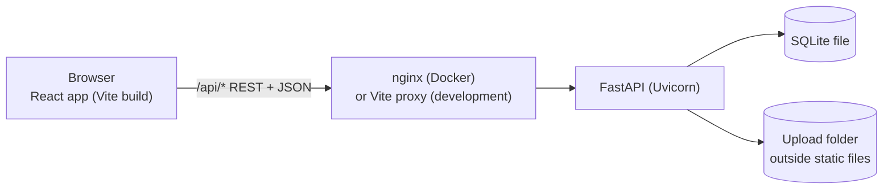
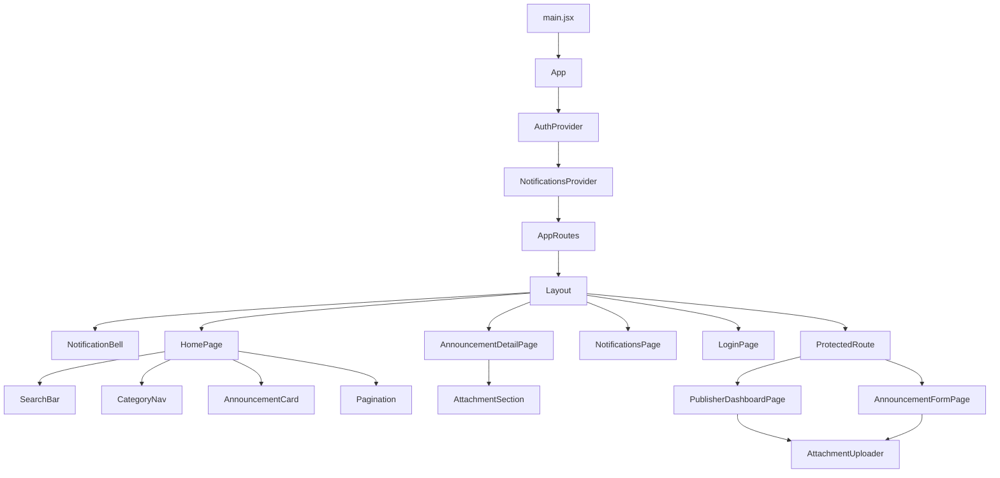

# System architecture



One React app, one FastAPI app, one SQLite database. In development, Vite forwards `/api` to Uvicorn on port 8000. In Docker, nginx serves the built React app and forwards `/api` to the backend container.

## Where each feature's code lives
```text
backend/                     entry point, database, errors, settings, shared schemas (infrastructure only)
frontend/src/                entry point, API client, route table, design tokens (infrastructure only)
features/<feature>/backend/  that feature's models, schemas, services, routes
features/<feature>/frontend/ that feature's React pages, components, API calls
features/<feature>/tests/    that feature's pytest and Vitest tests
```
`backend/main.py` registers every feature's router. `frontend/src/routes/AppRoutes.jsx` connects every feature's pages. Nothing is duplicated.

## Layers (backend)
`route -> service -> model`. Routes only read the request and shape the response. Services hold business rules and talk to the database. Models describe tables. Pydantic schemas validate input and describe output.

## Integration contracts
| Contract | Owner | Used by |
|---|---|---|
| `get_db`, `get_settings` (`backend/dependencies.py`) | core-announcement-engine | all routes |
| `get_current_publisher`, `get_optional_publisher` | publisher-auth | all protected routes |
| Events `announcement.published / unpublished / deleted` (`backend/shared/events.py`) | core-announcement-engine announces | search-notifications creates or removes notifications; notice-details deletes files |
| `published_query()` | core-announcement-engine | search-notifications's search |
| `AttachmentSummary` schema | core-announcement-engine (shared) | notice-details's table, everyone's responses |
| Error format `{"error": {code, message, fields}}` | core-announcement-engine | every endpoint and the React API client |
| `api()` client (`frontend/src/api/client.js`) | core-announcement-engine | all React API modules |
| `AttachmentUploader` component | notice-details | core-announcement-engine's form |
| `StateMessage`, `CategoryBadge`, `Layout` | student-dashboard | all pages |
| `AuthContext` / `useAuth` | publisher-auth | layout, protected routes, pages |

## Why events for notifications and files?
When an announcement is published, the core code only says "published". search-notifications's code listens and creates a notification. core-announcement-engine never imports notification code, so each member can change their part without breaking the others.

## Frontend component architecture

