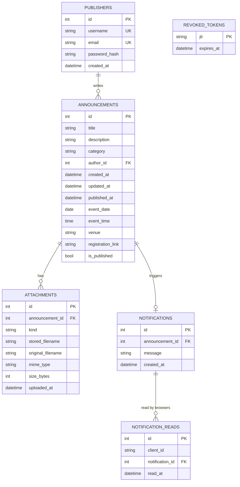

# Database design (SQLite via SQLAlchemy)

The file is `instance/campusconnect.db` (or `/data/campusconnect.db` in Docker). Tables are created automatically on start.

| Table | Owner | Notes |
|---|---|---|
| `publishers` | publisher-auth | `password_hash` is Argon2 (old Werkzeug hashes upgrade on login) |
| `announcements` | core-announcement-engine | CHECK: category is one of the four. Index on `(is_published, published_at)`. `published_at` is set the first time it is published. |
| `attachments` | notice-details | `UNIQUE(announcement_id, kind)`: at most one poster and one PDF. `stored_filename` is random; `original_filename` is shown to users. |
| `notifications` | search-notifications | One per published announcement. Removed on unpublish. |
| `notification_reads` | search-notifications | `UNIQUE(client_id, notification_id)`. `client_id` is a random id kept in the browser. |
| `revoked_tokens` | publisher-auth | Logged-out token ids, tidied once expired. |

Deleting an announcement removes its attachments (rows and files) and notifications. Foreign keys are switched on for every connection (`backend/database.py`). To reset during development, stop the server and delete the `instance/` folder.
