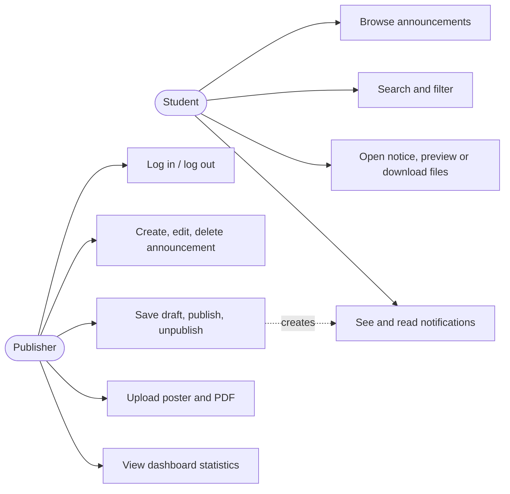

# Requirements specification

## Functional requirements
| ID | Requirement | Owner |
|---|---|---|
| F1 | Students view published announcements without logging in, newest first | Moksh, Mridul |
| F2 | Four fixed categories; filter by category | Mihir, Mridul, Moksh |
| F3 | Each announcement has title, description, category, optional venue, date, time, registration link, created/updated/published dates | Mihir |
| F4 | Individual announcement page | Nayeem |
| F5 | Publisher login and logout; protected publisher pages | Aariz |
| F6 | Publisher dashboard with statistics | Mihir |
| F7 | Create, edit, delete; save drafts; publish and unpublish | Mihir |
| F8 | A publisher can change only their own announcements | Mihir, Aariz |
| F9 | Upload a poster (png, jpg, webp, up to 3 MB) and a PDF (up to 5 MB); validate type and size | Nayeem |
| F10 | Preview, view and download documents; handle missing files | Nayeem |
| F11 | Keyword search over title, description and venue | Mridul |
| F12 | Notification bell, unread count, list, mark one/all as read | Mridul |
| F13 | Loading, empty and error states everywhere | Moksh |

## Non-functional requirements
- **Security:** hashed passwords, JWT with expiry, server-side authorisation, validated uploads stored outside public folders, CORS limited to known origins.
- **Honesty about notifications:** read state is per browser because students have no accounts.
- **Usability:** responsive from phone to desktop; labelled form fields; keyboard-usable; colour contrast checked.
- **Reliability:** all data in SQLite; tests never touch the development database.
- **Maintainability:** each member owns a folder; shared code is limited to infrastructure; one error format and one API style.
- **Simplicity:** no microservices, queues, caches or websockets.

## Use cases

